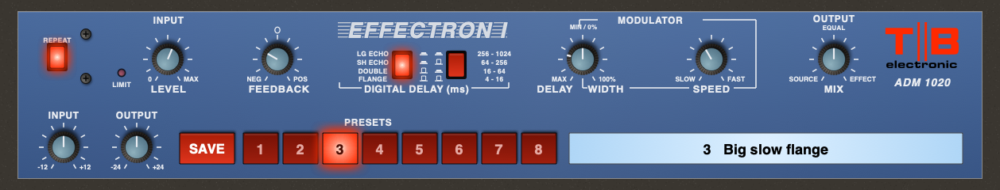

# TB Effectron (2026 Mac)

TB Effectron for current Macs: **CLAP, VST3 and AU**, universal (Apple Silicon and Intel),
**macOS 11 and later**. Use it in Reaper, FL Studio, Logic, GarageBand, Tape16 and other hosts.

The sound and panel are the same as the Mac OS X 10.8.5 VST build
([TB-Effectron-Mountain-Lion](https://github.com/tonybuzzcock/TB-Effectron-Mountain-Lion)). The DSP
code is identical, and the test suite checks that the plugin's output matches it sample for sample.
It's a model of the **DeltaLab Effectron I, ADM 1020** adaptive delta modulation delay, built from
DeltaLab's published specifications and the user's front-panel photo (in `Docs/`); there's no
schematic. Personal, non-commercial use.

## Install

GitHub → Actions → latest run → Artifacts → `TB-Effectron-mac`, unzip, then follow `INSTALL.txt`.
In short:

- `TB Effectron.vst3` → `VST3/`
- `TB Effectron.component` → `Components/`
- `TB Effectron.clap` → `CLAP/`

These folders are in `/Library/Audio/Plug-Ins/` (the main Library) or `~/Library/Audio/Plug-Ins/`
(your user Library). Use whichever one your other plugins are in. Apple hasn't notarised the
plugins, so run the short Terminal lines in `INSTALL.txt` for the folder you used. Then rescan
plugins in your DAW.

## Controls

| Name | Control | Range |
|------|---------|-------|
| Input Level | INPUT LEVEL (LIMIT LED lights above 2 V at the converter) | 0 – 10, unity at 5.75 |
| Feedback | NEG (inverted repeats) – 0 at 12 o'clock – POS | −100 – +100 % |
| Digital Delay Range | the two red buttons | Flange 4–16, Double 16–64, Sh Echo 64–256, Lg Echo 256–1024 ms |
| Delay | outer black knob: MAX fully left, MIN at 12; past 12 the envelope follower | ms, or Env 0–100 % |
| Width | inner teal cap, 12 to 5 o'clock: LFO sweep | 0 – 100 % (8:1) |
| Speed | LFO rate | 0.05 – 12 Hz |
| Mix | SOURCE – EQUAL – EFFECT | 0 – 100 % effect |
| Repeat | infinite repeat (rear footswitch on the unit); DELAY then changes the loop's pitch | On / Off |
| Input, Output | *plugin only*: input and output trims | ±12 dB, ±24 dB |

**Presets**: SAVE, then a slot 1–8, then type a name and press Return (Esc skips the name).
A slot shows its number and name in the readout; click the readout to rename the preset in use.
Presets live in `~/Library/Application Support/TB/TB Effectron/Presets.txt` and are shared by all
three formats.

How the model works, and the values that are estimates, are described in the
[Mountain Lion repo's README](https://github.com/tonybuzzcock/TB-Effectron-Mountain-Lion#how-its-modelled).

## Build

`cmake -B build && cmake --build build` (clap-wrapper v0.17.0 and the SDKs download at configure
time). GitHub Actions builds universal binaries, checks both architectures and macOS 11.0, runs the
CLAP host test, the DSP and preset tests, the panel test (screenshots to `gui-preview`), auval,
clap-validator and pluginval, and ad-hoc signs the bundles.
